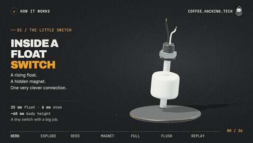
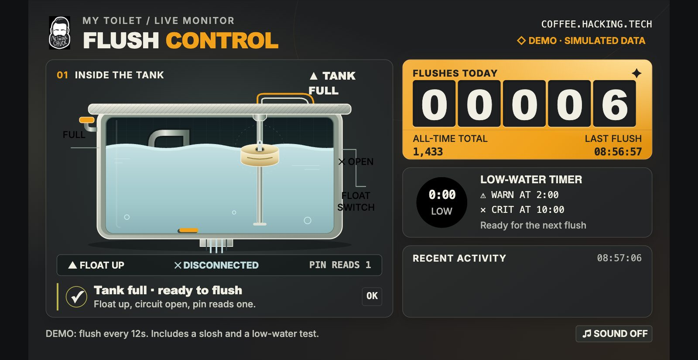

<div align="center">

# My toilet has an IP address

**The companion guide to the NetworkChuck video.**<br>
A float switch in the toilet tank, an old Raspberry Pi, and a little Python that knows the second your toilet flushes.

<br>

[](guide/01-what-you-need.md)
[](#the-path)
[](LICENSE)



</div>

---

## Why?

Every time my editors flushed the toilet, it seemed like all of our computers dropped off the NAS and even the internet hiccupped. I didn't know why. I just knew the flush and the disconnect kept showing up together. So I wanted to know exactly when that toilet flushes, to the second, and line it up against everything else on the network. That's the whole game in IT: when something weird happens, log everything around it.

Also, I joked about giving my toilet an IP address back in my subnetting series. Now it has one.

## How it works

```
float switch in the tank ──► GPIO17 + ground on the Pi ──► toilet_watch.py (checks 10x a second)
                                                                │
                              ┌─────────────────────────────────┼──────────────────────────┐
                              ▼                                 ▼                          ▼
                     state.json (every flush)        Flush Control page :8080       Slack message
```

- The float switch is two metal strips in a glass tube with a magnet in the float. Tank full, float up, strips apart. Flush, float drops, strips touch.
- The Pi's built-in **pull-up resistor** holds the pin at 3.3 V (reads `1`). When the switch closes it connects the pin to ground (reads `0`). Without the pull-up, stray electrical noise would look like flushes all day.
- The script checks the pin every 0.1 seconds. The water has to stay low for **1 full second** to count, so sloshing never counts as a flush.

## The Flush Control page



It runs on the Pi at port 8080 and updates live: the water drops, the timer counts, and the counter flips on every real flush.

## The path

Do them in order. Test on the desk before anything goes near water.

| # | Chapter | What you do |
|---|---|---|
| 1 | [What you need](guide/01-what-you-need.md) | The parts list. It's short. |
| 2 | [Flash the Pi](guide/02-flash-the-pi.md) | Raspberry Pi OS Lite 64-bit, SSH on, no monitor needed |
| 3 | [Wire the float switch](guide/03-wire-it-up.md) | Two wires: pin 9 (ground) and pin 11 (GPIO17) |
| 4 | [Test it on the desk](guide/04-test-on-the-desk.md) | Install the watcher, open the live page, flush it by hand |
| 5 | [Put it in the toilet](guide/05-into-the-tank.md) | Zip ties, a spacer, and a lot of hand washing |
| 6 | [Slack alerts](guide/06-slack-alerts.md) | Your whole team finds out every time someone flushes |
| + | [Going further](guide/07-going-further.md) | Checkmk, a running-toilet alarm, troubleshooting |

## Quick start

Already flashed and wired? On the Pi:

```bash
sudo apt install -y git
git clone https://github.com/theNetworkChuck/toilet-monitor-guide
sudo bash toilet-monitor-guide/pi/install.sh
```

Then open `http://<your-pi's-ip>:8080`.

## Files in this repo

```
pi/
  toilet_simple.py       the whole idea in 15 lines (great for learning)
  toilet_watch.py        the real watcher: counts flushes, writes state.json, posts to Slack
  toilet-watch.service   runs the watcher on boot (systemd)
  toilet-watch.default   your settings (pin, switch direction, Slack)
  install.sh             installs everything, safe to run again
  slack-test.sh          sends one test message to Slack
  live/                  the Flush Control page (server.py + index.html)
checkmk/toilet-localcheck   optional Checkmk local check
test/                    logic tests with a fake clock (run them on any computer)
```

## A small disclaimer

This is a very dumb project with a real IT lesson inside it. Keep the Pi and every bit of mains power **outside** the tank and away from water. Only the float switch and its low-voltage wires go in the tank.
