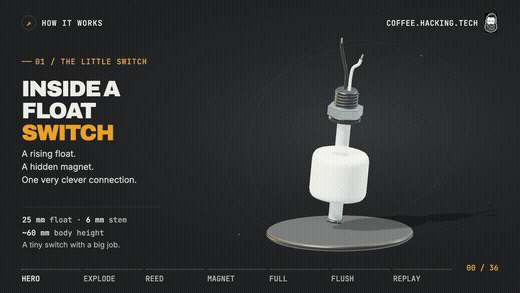

# 1. What you need

[◀ Back to the guide](../README.md) · Next: [Flash the Pi ▶](02-flash-the-pi.md)

| Part | Notes |
|---|---|
| **A Raspberry Pi with GPIO pins** | I used an old Raspberry Pi 3 Model B+. Any Pi with the 40-pin header works (3, 4, 5). A Zero 2 W works too, but get the **WH** version with the pins already on, or you'll be soldering. Plus its power supply. |
| **A microSD card** | 8 GB or bigger. |
| **A float switch** | Search Amazon for "float switch" or "liquid level float switch". The small vertical kind with a threaded stem and a float that slides up and down. They come in packs. Get a pack. |
| **Jumper wires** | Female ends to slide onto the Pi's pins. [Buy a million of these](https://geni.us/qSh67). |
| **Zip ties** | To hold the switch inside the tank. |
| **A small spacer** | Something about 1 cm thick between the switch and the tube it's tied to, so the float doesn't rub. I used a Lego. Half a wine cork works too. |
| **Something to mount the Pi** | On the wall beside the toilet, out of splash range. |

That's it. No resistors, no breadboard, no soldering (unless you want to).

## How a float switch works

There are two metal strips inside a glass tube. They almost touch. There's a magnet inside the float. When the float slides past the strips, the magnet pulls them together and the circuit closes. This kind of switch is called a **reed switch**.

For this project:

| Tank | Float | Switch | Pi pin reads |
|---|---|---|---|
| Full | Up | Open (strips apart) | `1` (high) |
| Flushing, water dropping | Down | Closed (strips touching) | `0` (low) |

Some float switches work the other way around (closed when up). That's fine. It's one setting, and chapter 4 shows you how to check yours.
