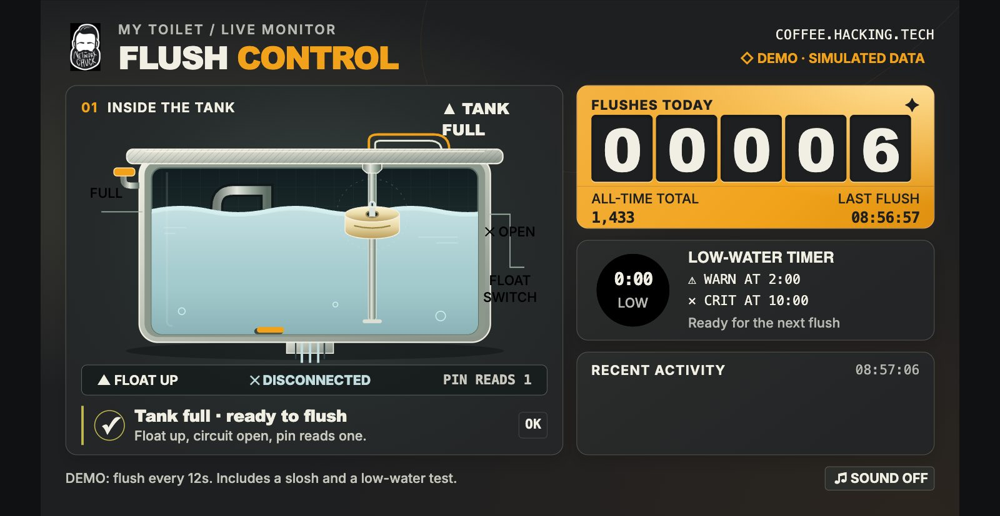

# 4. Test it on the desk

[◀ Wire the float switch](03-wire-it-up.md) · Next: [Put it in the toilet ▶](05-into-the-tank.md)

Before we get our hands dirty (literally), we prove it works outside the toilet.

## Get the code onto the Pi

SSH to the Pi, then:

```bash
sudo apt install -y git
git clone https://github.com/theNetworkChuck/toilet-monitor-guide
cd toilet-monitor-guide
```

## Step 1: watch the raw switch

```bash
sudo apt install -y python3-gpiozero python3-lgpio
python3 pi/toilet_watch.py raw
```

It prints the switch state twice a second. Hold the float switch upright and slide the float up and down with your finger:

```
switch open
switch open
switch CLOSED     ← float down
switch CLOSED
switch open       ← float back up
```

Write down which one you see with the **float up** (tank full). Press `Ctrl+C` to stop.

| Float up shows... | Your setting |
|---|---|
| `switch open` | `TOILET_FULL_WHEN=open` (the default, nothing to change) |
| `switch CLOSED` | `TOILET_FULL_WHEN=closed` (your switch works the other way around) |

Nothing changes at all? Check the two wires are really on pins 9 and 11 and actually touching metal.

## Step 2: the whole idea in 15 lines

[`pi/toilet_simple.py`](../pi/toilet_simple.py) is the entire project in its simplest form:

```python
from gpiozero import Button
import time

switch = Button(17, pull_up=True)   # float switch on GPIO17 + ground
flushes = 0

while True:
    if switch.is_pressed:            # wires connected = float dropped
        time.sleep(1)                # wait one second...
        if switch.is_pressed:        # ...still low? that's a real flush
            flushes += 1
            print("FLUSH!", flushes)
            while switch.is_pressed:       # wait for the tank to refill
                time.sleep(0.1)
    time.sleep(0.1)
```

`Button(17, pull_up=True)` is the pull-up resistor from chapter 3. `is_pressed` is `True` when the switch is closed. Run it, drop the float, hold it down for a second:

```bash
python3 pi/toilet_simple.py
```

```
FLUSH! 1
```

Flick it down and right back up and nothing happens. That's on purpose: water sloshing around in the tank is not a flush. It has to stay down for a full second.

> If your switch is the closed-when-up kind, swap `is_pressed` for `not switch.is_pressed` in this little script. The real watcher below handles it with a setting.

## Step 3: install the real watcher and the live page

[`pi/toilet_watch.py`](../pi/toilet_watch.py) is the grown-up version. It checks the pin every 0.1 seconds, counts flushes (today and all time), times how long the tank stays low, survives reboots, and writes everything to `/var/lib/toilet-monitor/state.json`.

If your switch is closed when the float is up, set that first:

```bash
sudo nano pi/toilet-watch.default      # change TOILET_FULL_WHEN=open to closed
```

Then install:

```bash
sudo bash pi/install.sh
```

The installer sets up two services that start on every boot:

| Service | What it does |
|---|---|
| `toilet-watch` | Reads the float switch and writes `state.json` |
| `toilet-live` | The **Flush Control** page on port 8080 |

It ends with something like:

```
watcher: active    page: active
Open http://192.168.1.50:8080 in your browser.
```

Your settings are now in `/etc/default/toilet-watch`. Edit that file later, not the one in the repo, then run `sudo systemctl restart toilet-watch toilet-live`. (Changed `TOILET_GPIO` to a different pin? Re-run `sudo bash pi/install.sh` instead, so the page follows it too.)

## Step 4: flush it by hand



Open the page in your browser. You'll see the tank, the float, a flush counter, and a low-water timer.

Drop the float and hold it down. The water in the drawing drops, the low-water timer starts counting, and after a second: **FLUSH!** Let go and the tank "refills".

Now flick it down and up fast. No flush. Even a little too fast doesn't count. It has to be longer.

What's behind the page:

```bash
cat /var/lib/toilet-monitor/state.json
```

```json
{"tank": "full", "full_when": "open", "low_since": null, "flushes_total": 3,
 "flushes_today": 3, "day": "2026-11-11", "last_flush": 1794409620.4, "updated": 1794409631.1}
```

`last_flush` is a Unix timestamp: the exact moment the water started dropping. That's the number you line up against your network logs.

Want to see the page before your Pi is even wired? Add `?demo=1` to the address and it plays a fake flush every 12 seconds.

Clear your test flushes before it goes in the tank:

```bash
sudo bash pi/install.sh reset
```

It works. Let's go put it in a toilet.
