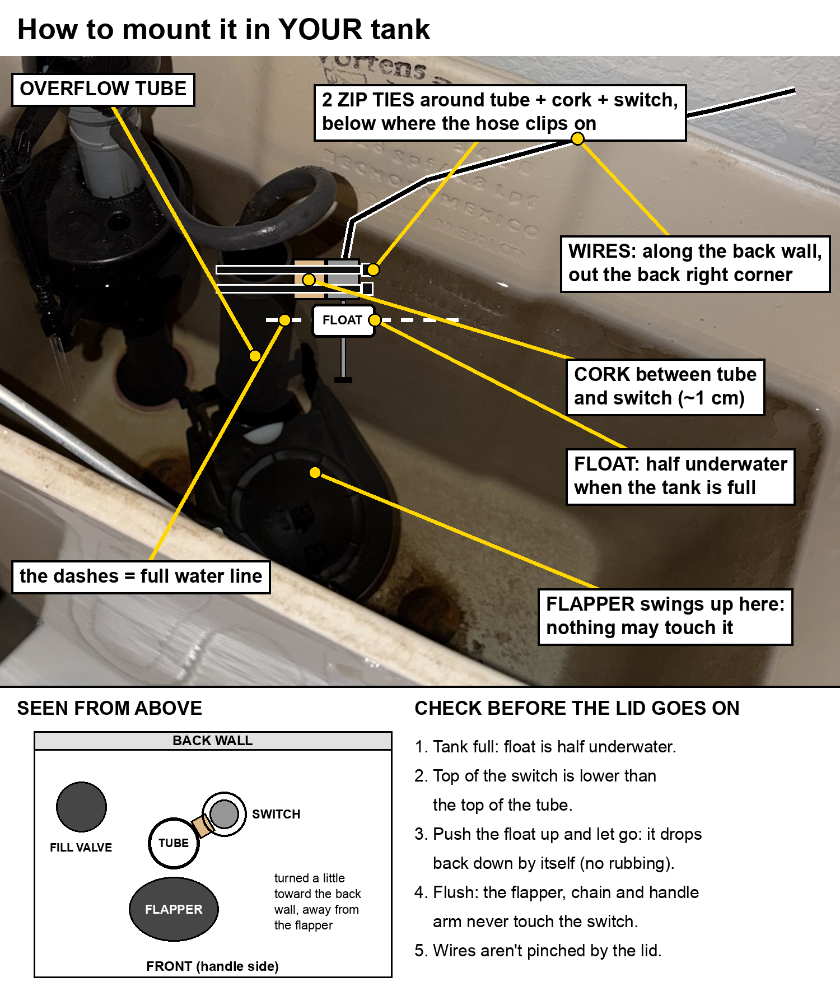
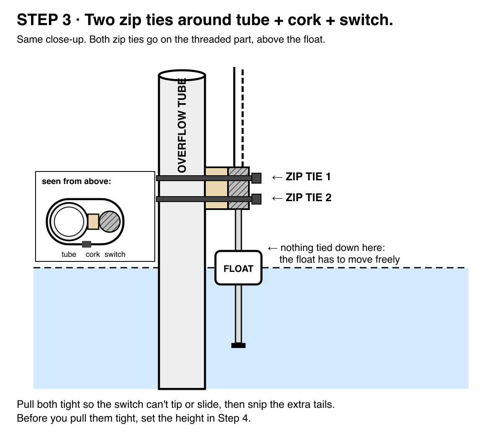

# 5. Put it in the toilet

[◀ Test it on the desk](04-test-on-the-desk.md) · Next: [Slack alerts ▶](06-slack-alerts.md)

Attaching it to the toilet was honestly the hardest part. It took me a few tries, a few zip ties, and a lot of hand washing. (It's clean water in the tank. It still feels gross.)

> ⚠️ Only the float switch and its two low-voltage wires go in the tank. The Pi and its power supply stay outside, on the wall, away from water. Unplug the Pi while you work.

## Where it goes

Tie the switch to the **overflow tube**, the open-topped tube in the middle of the tank. Two zip ties around the tube, a spacer, and the switch.

The rules that matter (the drawing's "Step 4" is rule 3 here):

1. **Use a spacer** (~1 cm) between the tube and the switch. The float is wider than the switch stem. Tie the switch flush against the tube and the float rubs and sticks. I used a Lego. Half a cork works too.
2. **Zip ties go on the threaded stem above the float**, never around the float. The float has to slide freely.
3. **Set the height** so the float sits about half underwater when the tank is full. When you flush, the water has to drop below the float.
4. **The top of the switch stays below the top of the overflow tube.**
5. **Keep it clear of the flapper**, the chain and the handle arm. Turn the switch a little toward the back wall. Flush with the lid off and watch: nothing may touch it.
6. **Run the wires along the back wall** and out a back corner, where the lid won't pinch them. Leave a little droop (a drip loop) in the wire before it reaches the Pi, so water from a sweaty tank drips off instead of running down into the Pi.

## Check before the lid goes on

1. Tank full: the float is half underwater.
2. Push the float up and let go: it drops back down by itself, no rubbing.
3. Flush: the flapper, chain and handle never touch the switch.
4. The wires aren't pinched by the lid.

## Time for a flush

Plug the Pi back in, open the Flush Control page and flush for real.

The water drops, the timer starts, and **FLUSH!** The counter goes up. Flush again. Up again. Your toilet has an IP address.

If it counts nothing, run `sudo systemctl stop toilet-watch`, then `python3 /opt/toilet-monitor/toilet_watch.py raw` and flush. If the switch reads the same state full and empty, the float isn't dropping below the switch: move it up. If it reads backwards, flip `TOILET_FULL_WHEN` in `/etc/default/toilet-watch`. Run `sudo systemctl start toilet-watch` when you're done.
